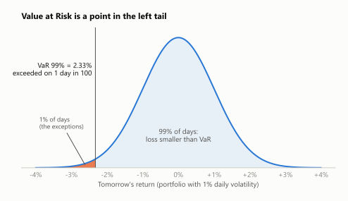
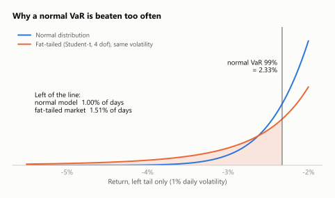
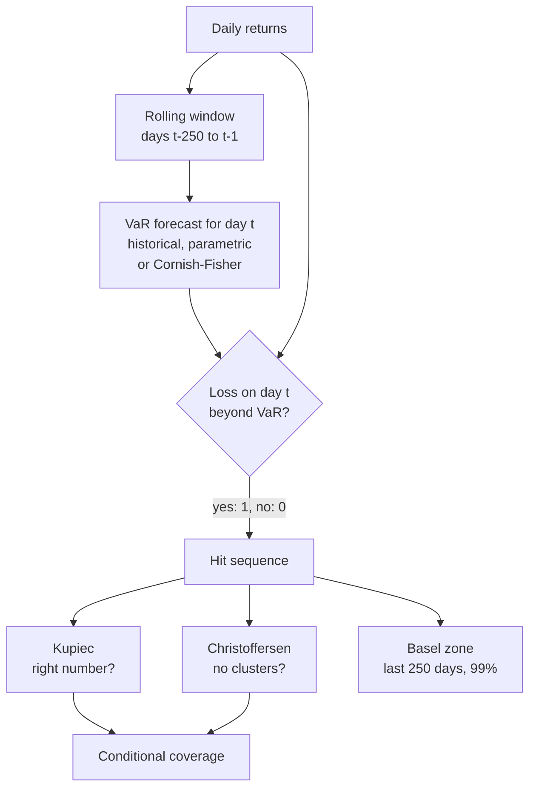
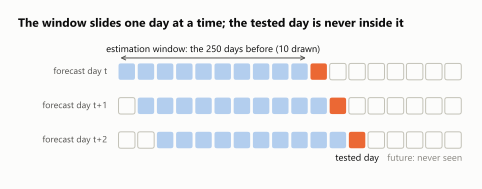
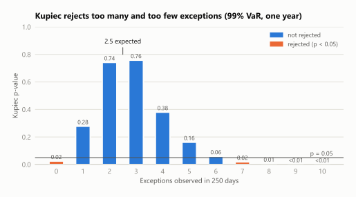
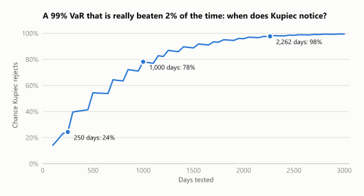
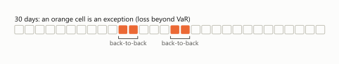
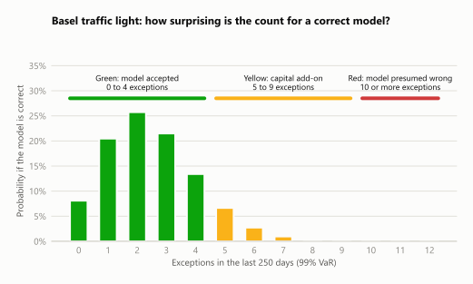
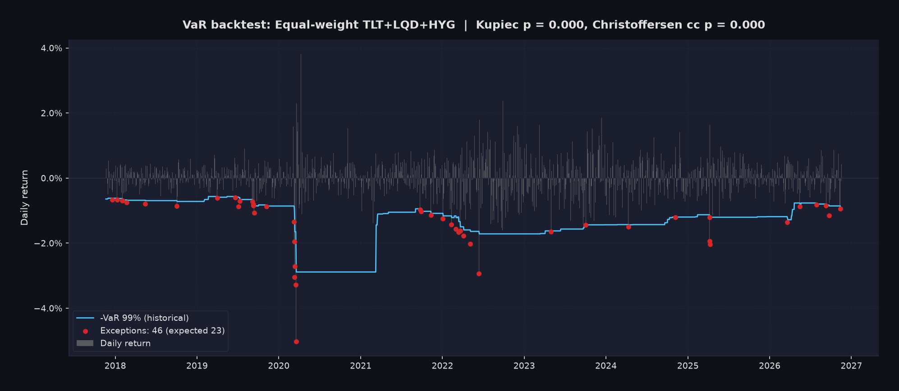

# VaR backtesting, from zero

A guide to the theory behind MacroQuant's `backtest_var` tool: what Value at Risk is, how the three VaR models in the project compute it, how a backtest decides whether a model can be trusted, and how to run one yourself.

No prior statistics is assumed beyond "an average" and "a standard deviation". Every number in the worked examples was produced by the project's own code (`macro_quant/analytics/backtest.py`), so you can rerun them and get the same digits.

**Contents**

1. [Value at Risk in one paragraph](#1-value-at-risk-in-one-paragraph)
2. [The three VaR models in MacroQuant](#2-the-three-var-models-in-macroquant)
3. [Why a VaR must be backtested](#3-why-a-var-must-be-backtested)
4. [Just enough statistics: hypothesis tests and p-values](#4-just-enough-statistics-hypothesis-tests-and-p-values)
5. [Test 1: Kupiec, is the number of exceptions right?](#5-test-1-kupiec-is-the-number-of-exceptions-right)
6. [Test 2: Christoffersen, do exceptions come in bunches?](#6-test-2-christoffersen-do-exceptions-come-in-bunches)
7. [Test 3: conditional coverage, both at once](#7-test-3-conditional-coverage-both-at-once)
8. [The Basel traffic light](#8-the-basel-traffic-light)
9. [Reading the real results](#9-reading-the-real-results)
10. [How to use the system](#10-how-to-use-the-system)
11. [Pitfalls](#11-pitfalls)
12. [Glossary](#12-glossary)
13. [References](#13-references)

---

## 1. Value at Risk in one paragraph

You hold a portfolio worth \$1,000,000. Tomorrow it will gain or lose some amount you cannot know in advance. **Value at Risk (VaR)** answers one precise question:

> What loss will I *not* exceed tomorrow, with 99% confidence?

If the answer is "\$23,000", it means: on 99 days out of 100 the loss should stay below \$23,000, and on about 1 day in 100 it will be worse. VaR says nothing about *how much* worse that bad day is (that is the job of Expected Shortfall, also called CVaR, which MacroQuant also computes).

Formally, call $r$ tomorrow's return (a fraction: $-0.02$ means a 2% loss) and $c$ the confidence level (0.95 or 0.99). VaR is the number such that

$$
P\left(r < -\text{VaR}\right) = 1 - c = p
$$

$p$ is the **exception probability**: 5% at 95% confidence, 1% at 99%. In MacroQuant, VaR is reported as a **positive fraction of the portfolio** (`VaRResult.var_pct`), so a VaR of 0.0233 means "2.33% of the portfolio".

Graphically, VaR is a point on the left tail of the distribution of returns, the point that leaves exactly $p$ of the probability to its left:

<picture>
  <source media="(prefers-color-scheme: dark)" srcset="img/guide/var_tail-dark.svg">
  
</picture>

The entire difficulty is that we do not know this distribution. We only see the past, and each VaR model is a different guess at the shape of the left tail.

## 2. The three VaR models in MacroQuant

All three live in `macro_quant/analytics/risk.py` (`RiskEngine.var_historical`, `var_parametric`, `var_cornish_fisher`). Each one takes a window of past daily returns and returns a VaR.

### 2.1 Historical VaR: trust the past as it was

Sort the past returns from worst to best and read off the one that has 1% of the observations below it. No assumption about the shape of the distribution.

$$
\text{VaR}_{\text{hist}} = -\,Q_{p}(r_1, \dots, r_n)
$$

where $Q_p$ is the empirical $p$-quantile (numpy's `percentile`, which interpolates linearly between neighbours).

**Example.** With a window of 250 returns at 99%, the quantile sits at position $(250-1)\times 0.01 = 2.49$ in the sorted list (counting from 0), so the VaR is an interpolation between the 3rd and the 4th worst day of the year. That is the weak spot of this method: the whole 99% VaR rests on two or three observations. One more crash in the window and it jumps; the crash leaves the window 250 days later and it drops.

### 2.2 Parametric VaR: assume a bell curve

Assume returns follow a normal distribution, estimate its mean $\mu$ and standard deviation $\sigma$ from the window, and read the quantile from the normal table:

$$
\text{VaR}_{\text{param}} = -(\mu + z_p\,\sigma)
$$

$z_p$ is the standard normal quantile: $z_{0.05} = -1.645$, $z_{0.01} = -2.326$.

**Example.** $\mu = 0$, $\sigma = 1\%$ daily, 99% confidence:

$$
\text{VaR} = -(0 + (-2.326) \times 0.01) = 0.02326 = 2.33\%
$$

On \$1,000,000 that is \$23,263. Smooth and stable, but if real returns have **fat tails** (big moves more frequent than the bell curve says, which is the rule in credit markets), this VaR is too small and gets beaten too often. The figure compares a normal distribution with a fat-tailed one of exactly the same volatility: beyond the normal 99% VaR, the fat-tailed market puts 1.51% of days instead of 1%, so a normal VaR would be beaten half as often again as it promises.

<picture>
  <source media="(prefers-color-scheme: dark)" srcset="img/guide/fat_tails-dark.svg">
  
</picture>

### 2.3 Cornish-Fisher VaR: bend the bell curve

Keep the parametric formula but replace $z_p$ by a corrected quantile that accounts for the two ways real returns differ from a bell curve:

- **Skewness** $S$: asymmetry. Negative skew means the big moves are mostly losses.
- **Excess kurtosis** $K$: fat tails. 0 for a normal distribution, positive when extreme days are more frequent.

$$
z_{cf} = z + \frac{(z^2-1)\,S}{6} + \frac{(z^3-3z)\,K}{24} - \frac{(2z^3-5z)\,S^2}{36}
\qquad
\text{VaR}_{cf} = -(\mu + z_{cf}\,\sigma)
$$

**Example.** Same $\mu = 0$, $\sigma = 1\%$, 99%, but now $S = -0.5$ and $K = 3$ (typical of a credit ETF):

| Term | Value |
|---|---|
| $z$ | $-2.326$ |
| $(z^2-1)S/6$, skew correction | $-0.368$ |
| $(z^3-3z)K/24$, fat-tail correction | $-0.701$ |
| $-(2z^3-5z)S^2/36$, second-order skew | $+0.094$ |
| $z_{cf}$ | $-3.301$ |

The VaR goes from 2.33% to **3.30%**: about 42% larger, purely because the tails are fatter and skewed toward losses.

### 2.4 Summary

| Model | Assumption | Strength | Weakness |
|---|---|---|---|
| Historical | the next year looks like the last one | no shape assumption | 99% VaR rests on 2 or 3 points; jumps when a crash enters or leaves the window |
| Parametric | returns are normal | smooth, stable | underestimates fat tails |
| Cornish-Fisher | normal, corrected for skew and kurtosis | captures fat tails | skew and kurtosis are themselves noisy on 250 days |

All three share one more assumption, which will matter in section 9: every day of the window counts **equally**. A calm day eleven months ago weighs as much as yesterday's turmoil.

## 3. Why a VaR must be backtested

A VaR is a **falsifiable promise**. A 99% VaR promises two things:

1. **Right frequency.** The loss exceeds VaR on about 1% of days. Not 2%, but not 0.1% either: a VaR that is never beaten is too conservative and ties up capital for nothing.
2. **No clustering.** The bad days are spread out at random. If an exception today makes one tomorrow more likely, the model is too slow to react when markets change, which is exactly when you need it.

A **backtest** checks both promises against what actually happened. The whole pipeline, as `backtest_var` runs it:



### 3.1 Exceptions and the hit sequence

A day is an **exception** (also called a breach or violation) when the realised loss is larger than the VaR forecast for that day:

$$
I_t = 1 \ \text{ if } r_t < -\text{VaR}_t, \qquad I_t = 0 \ \text{ otherwise}
$$

The list $I_1, I_2, \dots, I_n$ of zeros and ones is the **hit sequence**. Everything that follows is a test on this sequence. In code: `exceptions(returns, var)` returns it as a boolean Series.

### 3.2 Out-of-sample: never let the model see the answer

The VaR for day $t$ must be computed only from returns **strictly before** $t$. Otherwise the crash of day $t$ would already be in the window used to forecast it, and the model would look better than it is. This is called **look-ahead bias**, and it is the most common way to fake a good backtest.

`rolling_var(returns, method, confidence, window=250)` slides a 250-day window one day at a time:

<picture>
  <source media="(prefers-color-scheme: dark)" srcset="img/guide/rolling_window-dark.svg">
  
</picture>

The first 250 days only seed the window and are never tested. A test in the suite (`test_rolling_var_has_no_look_ahead`) changes every return from day 300 on and checks that the VaR forecasts up to day 300 do not move by a single digit.

## 4. Just enough statistics: hypothesis tests and p-values

Suppose a 99% VaR was beaten 5 times in 250 days, where 2.5 were expected. Is the model wrong, or was it bad luck? Some randomness is unavoidable: even a perfect model will not produce exactly 2.5 exceptions. A **hypothesis test** turns this into a number.

- The **null hypothesis** $H_0$ is "the model is correct".
- We compute a **test statistic** that measures how far the data are from what $H_0$ predicts. Larger means further.
- The **p-value** is the probability that a correct model would produce a statistic at least this large by pure luck.

**Decision rule used throughout MacroQuant:** if $p < 0.05$, reject the model (it is called "rejection at the 5% level"). In the code this is the field `reject_5pct`.

Two consequences to keep in mind:

- A correct model is still rejected **5% of the time** (a "false alarm"). Run 20 tests and you should expect one false rejection.
- "Not rejected" does not mean "proven correct". It means "the data are not strong enough to say it is wrong". With few observations, a test can miss a bad model (section 5.4).

### Likelihood ratio, in one sentence

All three tests below are **likelihood ratio (LR)** tests. The *likelihood* of a hypothesis is the probability it assigns to the data actually observed. The LR statistic compares the best explanation allowed under $H_0$ with the best explanation without restriction:

$$
LR = -2 \left[ \ln L(H_0) - \ln L(\text{best fit}) \right] \geq 0
$$

If $H_0$ explains the data almost as well as the best fit, $LR$ is close to 0. Statistical theory says that, when $H_0$ is true, $LR$ follows a **chi-squared distribution** whose "degrees of freedom" equal the number of constraints $H_0$ imposes. That is how a statistic becomes a p-value: `scipy.stats.chi2.sf(LR, dof)`. Useful landmarks: at 1 degree of freedom, $LR > 3.84$ means $p < 0.05$; at 2 degrees, $LR > 5.99$.

## 5. Test 1: Kupiec, is the number of exceptions right?

Kupiec's **proportion of failures (POF)** test (1995) checks promise 1 only.

### 5.1 Formula

With $n$ days tested, $x$ exceptions observed, $p$ the promised exception probability and $\hat p = x/n$ the observed rate:

$$
LR_{\text{pof}} = -2 \Big[ (n-x)\ln(1-p) + x \ln p \Big] + 2 \Big[ (n-x)\ln(1-\hat p) + x \ln \hat p \Big]
$$

The first bracket is the log-likelihood of the data if the true rate is $p$ (the model is right); the second is the log-likelihood with the best possible rate, the observed one. Under $H_0$, $LR_{\text{pof}}$ follows a chi-squared with 1 degree of freedom.

Edge cases: with $x = 0$ or $x = n$, a term like $0 \times \ln 0$ appears. By convention it equals 0 (the limit of $x \ln x$ as $x \to 0$), which the code implements in `_xlogy`.

### 5.2 Worked example

One year of a 99% VaR: $n = 250$, $x = 5$, $p = 0.01$, so $\hat p = 0.02$.

| Step | Value |
|---|---|
| $\ln L(p) = 245 \ln 0.99 + 5 \ln 0.01$ | $-25.488$ |
| $\ln L(\hat p) = 245 \ln 0.98 + 5 \ln 0.02$ | $-24.510$ |
| $LR = -2(-25.488 + 24.510)$ | $1.957$ |
| $p$-value $= P(\chi^2_1 > 1.957)$ | $0.162$ |

$0.162 > 0.05$: **not rejected**. Twice the expected number of exceptions over one year is still plausible luck.

```python
>>> from macro_quant.analytics.backtest import kupiec_pof
>>> kupiec_pof(250, 5, 0.01)
CoverageTest(statistic=1.956809788230622, p_value=0.1618549171960387, reject_5pct=False)
```

### 5.3 The whole picture on one year

The p-value for every possible count on 250 days at 99% (2.5 expected):

<picture>
  <source media="(prefers-color-scheme: dark)" srcset="img/guide/kupiec_pvalues-dark.svg">
  
</picture>

| Exceptions | 0 | 1 | 2 | 3 | 4 | 5 | 6 | 7 | 8 | 9 | 10 |
|---|---|---|---|---|---|---|---|---|---|---|---|
| Kupiec p | **0.025** | 0.278 | 0.742 | 0.758 | 0.381 | 0.162 | 0.059 | **0.019** | **0.005** | **0.001** | **0.000** |

Two things to notice. **Zero exceptions is rejected** ($p = 0.025$): a model that is never beaten is too conservative, and Kupiec penalises both directions. And on the high side, a model needs 7 exceptions in a year before Kupiec rejects it.

### 5.4 How much data does Kupiec need?

That last point is a real limitation. Suppose a model is actually wrong by a factor of two: it is beaten 2% of the time instead of 1%. How often would Kupiec catch it? Computed exactly from the binomial distribution:

<picture>
  <source media="(prefers-color-scheme: dark)" srcset="img/guide/kupiec_power-dark.svg">
  
</picture>

The curve climbs in steps rather than smoothly because exception counts are whole numbers: the rejection threshold jumps from one count to the next as the sample grows.

| Days tested | Chance of catching the bad model (power) | False alarm rate on a correct model |
|---|---|---|
| 250 (1 year) | 24% | 9.5% |
| 1,000 (4 years) | 78% | 5.5% |
| 2,262 (9 years, the README setup) | 98% | 4.4% |

On a single year, Kupiec misses a model that is twice too optimistic three times out of four. This is why the README results use nine years of tested days, and why the Basel rule (section 8) is a coarse traffic light rather than a fine-grained test. (The false alarm rate is not exactly 5% because exception counts are whole numbers.)

## 6. Test 2: Christoffersen, do exceptions come in bunches?

Kupiec only counts. A model could have exactly 1% exceptions, all of them in the same three weeks of a crisis. Christoffersen's **independence test** (1998) checks promise 2.

### 6.1 Transition counts

Look at every pair of consecutive days (yesterday, today) in the hit sequence and count the four possible transitions:

|  | today: no exception | today: exception |
|---|---|---|
| **yesterday: no exception** | $n_{00}$ | $n_{01}$ |
| **yesterday: exception** | $n_{10}$ | $n_{11}$ |

From them, two conditional probabilities:

$$
\pi_{01} = \frac{n_{01}}{n_{00}+n_{01}} \quad \text{(exception after a quiet day)}
\qquad
\pi_{11} = \frac{n_{11}}{n_{10}+n_{11}} \quad \text{(exception after an exception)}
$$

and the overall rate $\pi = \dfrac{n_{01}+n_{11}}{n_{00}+n_{01}+n_{10}+n_{11}}$.

If exceptions are independent, yesterday tells you nothing: $\pi_{01} = \pi_{11}$. If they cluster, $\pi_{11}$ is much larger than $\pi_{01}$.

### 6.2 Formula

$$
\ln L(\pi) = (n_{00}+n_{10})\ln(1-\pi) + (n_{01}+n_{11})\ln \pi
$$

$$
\ln L(\pi_{01},\pi_{11}) = n_{00}\ln(1-\pi_{01}) + n_{01}\ln\pi_{01} + n_{10}\ln(1-\pi_{11}) + n_{11}\ln\pi_{11}
$$

$$
LR_{\text{ind}} = -2\left[\ln L(\pi) - \ln L(\pi_{01},\pi_{11})\right] \sim \chi^2_1
$$

When a cell is empty (for example no exception was ever followed by another, $n_{11} = 0$), the same $0 \ln 0 = 0$ convention applies, and when no exception was ever followed by anything ($n_{10}+n_{11} = 0$, the last day is the only exception) $\pi_{11}$ is set to 0 so the statistic stays finite.

### 6.3 Worked example

A 30-day hit sequence with two pairs of back-to-back exceptions:

<picture>
  <source media="(prefers-color-scheme: dark)" srcset="img/guide/hit_sequence-dark.svg">
  
</picture>

The same sequence as zeros and ones:

```
0 0 0 0 0 0 0 0 0 0 | 1 1 0 0 0 1 1 0 0 0 | 0 0 0 0 0 0 0 0 0 0
```

| Quantity | Value |
|---|---|
| $n_{00}, n_{01}, n_{10}, n_{11}$ | 23, 2, 2, 2 |
| $\pi_{01} = 2/25$ | 0.08 |
| $\pi_{11} = 2/4$ | 0.50 |
| $\pi = 4/29$ | 0.138 |
| $\ln L(\pi)$ | $-11.635$ |
| $\ln L(\pi_{01},\pi_{11})$ | $-9.742$ |
| $LR_{\text{ind}}$ | 3.785 |
| p-value | 0.0517 |

An exception is six times more likely right after another one (50% against 8%), yet with only 30 days the test stops just short of rejecting ($0.0517 > 0.05$). Again: small samples make tests weak.

```python
>>> from macro_quant.analytics.backtest import christoffersen_independence
>>> hits = [0]*10 + [1, 1, 0, 0, 0, 1, 1, 0, 0, 0] + [0]*10
>>> christoffersen_independence(hits)
CoverageTest(statistic=3.785365973937399, p_value=0.0517026026897345, reject_5pct=False)
```

Independence can also be rejected in the other direction: exceptions that are *too regularly* spread out (fewer back-to-back pairs than chance would give). On the synthetic normal series used in the tests, one seed produced only 1 back-to-back pair where about 6.5 were expected, and independence was rejected at 95% for that reason. Repeated over 40 independent normal series, the rejection rate was 7.5%, consistent with the nominal 5% false alarm rate: that seed was simply unlucky.

## 7. Test 3: conditional coverage, both at once

Christoffersen's **conditional coverage** test simply adds the two statistics:

$$
LR_{cc} = LR_{\text{pof}} + LR_{\text{ind}} \sim \chi^2_2
$$

Two degrees of freedom because it tests two constraints at once (right rate *and* independence). It is the single best summary of whether a VaR model works, and the column the README results lead with.

On the example of section 6.3 with $p = 0.05$: $LR_{\text{pof}} = 3.073$ (p = 0.080) and $LR_{\text{ind}} = 3.785$ (p = 0.052). Neither rejects on its own, but together $LR_{cc} = 6.858$, p = **0.032**: rejected. Two pieces of weak evidence pointing the same way add up.

## 8. The Basel traffic light

Banks regulated under the Basel framework must backtest their 99% one-day VaR on the last 250 trading days, and the number of exceptions decides a penalty. The rule does not use a p-value; it asks where the count sits in the distribution of counts that a **correct** model would produce.

If the model is correct, each day is an independent coin flip with probability 1% of an exception, so the count follows a **binomial distribution** $\text{Bin}(250, 0.01)$. Its cumulative probability $P(X \leq x)$ decides the zone:

- **green** if $P(X \leq x) < 95\%$
- **yellow** if between 95% and 99.99%
- **red** if $P(X \leq x) \geq 99.99\%$

| Exceptions in 250 days | 0 | 1 | 2 | 3 | 4 | 5 | 6 | 7 | 8 | 9 | 10 |
|---|---|---|---|---|---|---|---|---|---|---|---|
| Probability of exactly that many | 8.1% | 20.5% | 25.7% | 21.5% | 13.4% | 6.7% | 2.7% | 1.0% | 0.3% | 0.08% | 0.02% |
| Cumulative $P(X \leq x)$ | 8.1% | 28.6% | 54.3% | 75.8% | 89.2% | 95.9% | 98.6% | 99.6% | 99.9% | 99.975% | 99.995% |
| Zone | green | green | green | green | green | yellow | yellow | yellow | yellow | yellow | red |

<picture>
  <source media="(prefers-color-scheme: dark)" srcset="img/guide/basel_zones-dark.svg">
  
</picture>

So: **0 to 4 green, 5 to 9 yellow, 10 or more red**. In the Basel framework (1996, carried into Basel II) the zone raises the multiplier applied to VaR when computing market-risk capital, from 3 in the green zone up to 4 in the red zone. (Those multiplier values come from the regulatory text, not from this project's code.)

```python
>>> from macro_quant.analytics.backtest import basel_zone
>>> basel_zone(6)
'yellow'
```

In MacroQuant the Basel zone is reported only at 99% and computed on the **last 250 tested days**, so it describes the most recent year, not the whole history. On fewer than 250 tested days it is `None`.

## 9. Reading the real results

The README section [VaR backtest: results](../README.md#var-backtest-results) applies all of the above to TLT (long Treasuries), LQD (investment-grade credit), HYG (high yield) and their equal-weight portfolio, over 2,262 tested days from 2017-11-20 to 2026-11-19. The chart for the portfolio is the best way into the numbers:



How to read it: grey bars are daily returns, the blue line is $-\text{VaR}$ (the loss the model said would not be exceeded), red dots are exceptions. Three things stand out, and each one maps to a concept from this guide.

**Exceptions cluster** (section 6). March 2020 alone produces six exceptions within a few days, the 2022 rate shock another long series, April 2025 a group of three. This is why the Christoffersen independence test rejects every 99% model in the results (highest p-value 0.010), including Cornish-Fisher, the one that gets the count right.

**The VaR line lags, then overreacts.** The line only drops after the crash, once the crash days are inside the window. It then stays at its widest for exactly 250 trading days and falls off a cliff in March 2021, the day March 2020 leaves the window. This is the "every day counts equally" assumption from section 2.4, made visible.

**Fat tails break the normal model** (section 2.2). At 99%, parametric VaR is beaten 2.65% of the time on HYG, more than twice the promise, while Cornish-Fisher, which corrects for fat tails, passes the count test (Kupiec) on all four instruments.

The conclusion follows from the three tests together. The tail **shape** problem is fixed by Cornish-Fisher; the **timing** problem is fixed by none of the three models, because none of them weights recent days more than old ones. A model that does (EWMA volatility scaling, filtered historical simulation, GARCH) is the natural next step, and this backtest is the tool that will tell whether it actually helps.

## 10. How to use the system

### 10.1 Through the assistant (MCP)

With the MCP server running (`python macro_quant/main.py --serve`, already configured in `.mcp.json` for Claude Code), just ask in plain language:

```
> Backtest the VaR models on HYG over the last 10 years
> Run a VaR backtest on an equal-weight portfolio of TLT, IEF and LQD at 97.5% and 99%
> Which VaR model would have held up best on LQD since 2018?
```

The assistant calls the tool `backtest_var` with these parameters, all optional:

| Parameter | Default | Meaning |
|---|---|---|
| `tickers` | `["TLT", "LQD", "HYG"]` | One ticker: backtest that ETF. Several: their equal-weight portfolio, rebalanced daily. |
| `years` | 10 | Years of daily history loaded from Yahoo. The first `window` days only seed the window. |
| `confidences` | `[0.95, 0.99]` | Each strictly between 0 and 1. |
| `window` | 250 | Rolling estimation window, in trading days. Minimum 30. |

It returns JSON with:

- `results`: one entry per method and confidence, with `n_exceptions`, `expected_exceptions`, `exception_rate`, and for each test (`kupiec`, `independence`, `conditional_coverage`) its `statistic`, `p_value` and `reject_5pct`, plus `basel_zone` at 99%.
- `summary`: the same as a text table (see below).
- `chart`: path to a PNG like the one above, for historical VaR at 99% (or the highest confidence requested).

Errors come back as JSON too, for instance a confidence of 1.5 (`ValueError: confidence 1.5 must be strictly between 0 and 1`) or a ticker with less history than the window (`ValueError: window of 250 days exceeds the 120 available observations`).

### 10.2 From Python

The backtest is a set of pure functions on a pandas Series of daily returns: no network, no files. You can feed it anything, including made-up data, which is the best way to build intuition. This snippet backtests fat-tailed fake returns (Student-t with 3 degrees of freedom):

```python
import numpy as np
import pandas as pd

from macro_quant.analytics.backtest import backtest_var

rng = np.random.default_rng(42)
returns = pd.Series(rng.standard_t(3, 2000) * 0.006)   # fat-tailed fake returns

result = backtest_var(returns, "fat-tailed demo")
print(result.describe())
```

Output:

```
VaR backtest: fat-tailed demo | 250 to 1999 | rolling window 250 days
method           conf    obs   exc  expected    rate  Kupiec p   Indep p     CC p  Basel
----------------------------------------------------------------------------------------
historical        95%   1750    92      87.5   5.26%     0.624     0.679    0.814  -
historical        99%   1750    22      17.5   1.26%     0.299     0.454    0.440  green
parametric        95%   1750    76      87.5   4.34%     0.197     0.421    0.315  -
parametric        99%   1750    37      17.5   2.11%     0.000     0.810    0.000  yellow
cornish_fisher    95%   1750    92      87.5   5.26%     0.624     0.939    0.884  -
cornish_fisher    99%   1750    11      17.5   0.63%     0.094     0.709    0.229  green
p < 0.05 rejects the model at the 5% level.
```

Read it with the guide: on fat tails the normal model is beaten twice as often as promised at 99% (37 against 17.5, Kupiec p = 0.000), while independence is fine (the fake returns have no clustering by construction). Cornish-Fisher overcorrects slightly here (11 against 17.5) but stays within what luck allows (p = 0.094).

Individual results are on `result.results`:

```python
cf99 = next(m for m in result.results if m.method == "cornish_fisher" and m.confidence == 0.99)
cf99.n_exceptions, cf99.kupiec.p_value, cf99.basel     # (11, 0.0937, 'green')
```

The building blocks can be used one by one:

| Function | Does |
|---|---|
| `rolling_var(returns, method, confidence, window=250)` | Out-of-sample VaR series, one value per tested day |
| `exceptions(returns, var)` | Hit sequence (True on exception days) |
| `kupiec_pof(n_obs, n_exceptions, p)` | Section 5 |
| `christoffersen_independence(hits)` | Section 6 |
| `christoffersen_cc(hits, p)` | Section 7 |
| `basel_zone(n_exceptions, n_obs=250, p=0.01)` | Section 8 |
| `portfolio_returns({ticker: close_prices, ...})` | Equal-weight daily returns on common dates |
| `chart_var_backtest(result, method, confidence)` (in `analytics/charts.py`) | The chart, returns the PNG path |

### 10.3 Reproducing the README results

```bash
pip install -e ".[dev]"
python scripts/var_backtest_report.py      # needs network (Yahoo)
```

It prints one Markdown table per instrument and writes `docs/img/var_backtest_portfolio.png`. The figures of this guide come from `python scripts/guide_figures.py` (offline): every number they draw is computed by the project's code or by scipy's exact distributions. The setup (instruments, 10 years, window 250, 95% and 99%) is fixed in the script on purpose: changing it until the results look good would defeat the point of a backtest.

### 10.4 Running the tests

```bash
pytest macro_quant/tests/test_backtest.py -q
```

The tests are the best executable summary of this guide. They check the formulas against hand-computed values (sections 5.2 and 6.3), the edge cases (zero exceptions, no transition out of an exception), the absence of look-ahead, and three behaviours on synthetic data with known properties: normal returns do not reject the normal model, fat-tailed returns do, and volatility clustering (a GARCH process) makes the independence test reject.

## 11. Pitfalls

- **Many tests, some false alarms.** The README results run 24 tests at the 5% level per test type. Even with perfect models, about one rejection in twenty is luck. Look for patterns (all 99% models fail on credit) rather than at a single cell.
- **"Not rejected" is weak on short histories.** One year of data cannot tell a 1% model from a 2% model (section 5.4). Prefer long backtests.
- **Too few exceptions is also a failure.** A VaR that is never beaten is overstating risk.
- **Basel zone versus Kupiec.** They answer different questions: the Basel zone looks at the last 250 days only, Kupiec at the whole history. A model can be green today and rejected over nine years, or the reverse.
- **Data gaps.** Missing returns are dropped before the window is built, never counted as exceptions. In a portfolio, only dates where every ticker traded are kept.
- **Short histories.** A ticker with less than `window + 1` daily returns cannot be backtested; the tool raises a clear error instead of returning empty results.
- **Tiny windows.** A window under 30 days is refused: Cornish-Fisher needs at least 4 points to estimate kurtosis, and a VaR that cannot be computed would otherwise silently count as "never beaten".

## 12. Glossary

| Term | Meaning |
|---|---|
| VaR (Value at Risk) | Loss not exceeded with probability $c$ over one day |
| Confidence $c$ | 95% or 99%; $p = 1 - c$ is the promised exception probability |
| Exception, breach, violation | A day where the loss exceeded VaR |
| Hit sequence | The 0/1 list of exceptions, day by day |
| Out-of-sample | Forecast built only from data before the forecast day |
| Look-ahead bias | Using information from the future, makes a backtest look better than reality |
| Fat tails, excess kurtosis | Extreme moves more frequent than under a normal distribution |
| Skewness | Asymmetry of returns; negative means large moves are mostly losses |
| Volatility clustering | Calm and turbulent periods each tend to persist |
| p-value | Probability a correct model would look at least this bad by luck |
| Likelihood ratio (LR) | Statistic comparing the best fit under $H_0$ with the best fit overall |
| Chi-squared ($\chi^2$) | Distribution of LR statistics when $H_0$ is true |
| Power | Probability a test catches a model that is actually wrong |
| POF | Proportion of failures (Kupiec test) |
| Conditional coverage | Right rate and independence tested together |
| Expected Shortfall, CVaR | Average loss on the days beyond VaR |

## 13. References

- Kupiec, P. (1995). *Techniques for verifying the accuracy of risk measurement models.* Journal of Derivatives, 3(2), 73-84.
- Christoffersen, P. (1998). *Evaluating interval forecasts.* International Economic Review, 39(4), 841-862.
- Basel Committee on Banking Supervision (1996). *Supervisory framework for the use of "backtesting" in conjunction with the internal models approach to market risk capital requirements.*
- Jorion, P. *Value at Risk: The New Benchmark for Managing Financial Risk.* McGraw-Hill. Chapter on backtesting: the most readable textbook treatment.
- Cornish, E. A. and Fisher, R. A. (1938). *Moments and cumulants in the specification of distributions.* Revue de l'Institut International de Statistique, 5(4), 307-320.
